  

  

  
  
  
  

## 🔭 About me

- 🐍 Python, heading into data science
- 📡 Messing around with radio telescope data
- 👽 Interested in SETI
- 🌱 Learning: Astropy, signal processing, English

<i>📡 still listening...</i>

